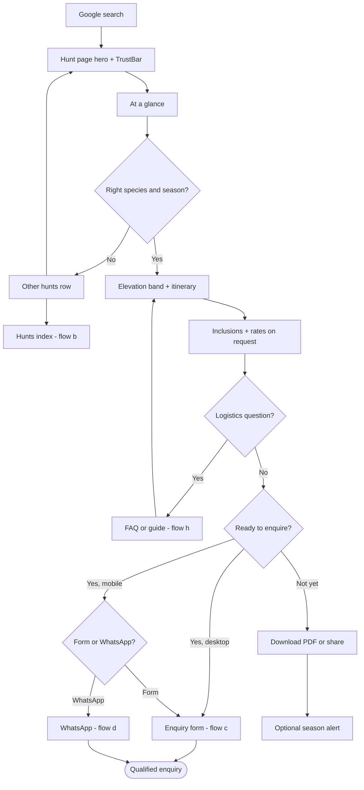
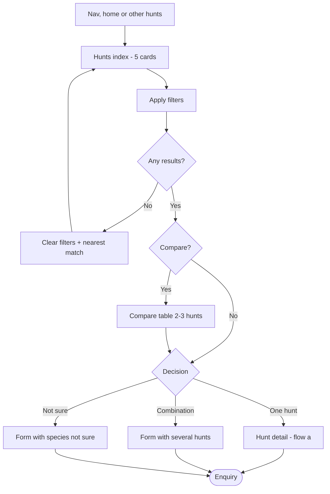
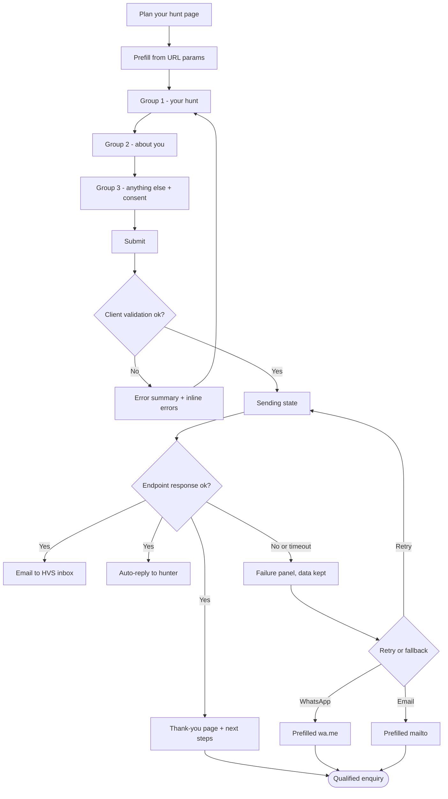
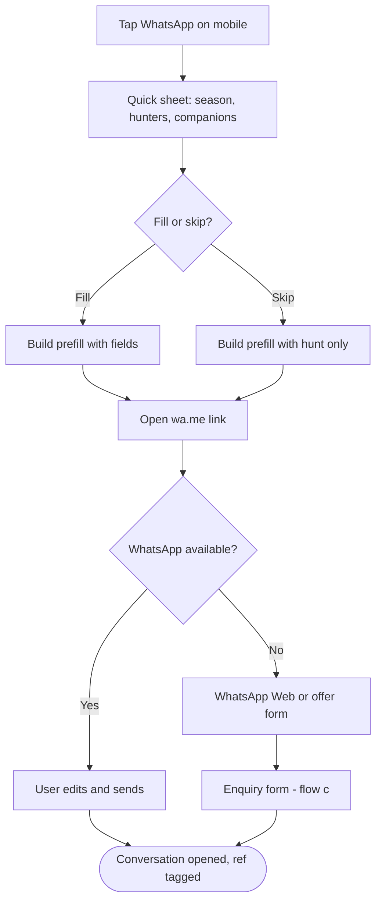
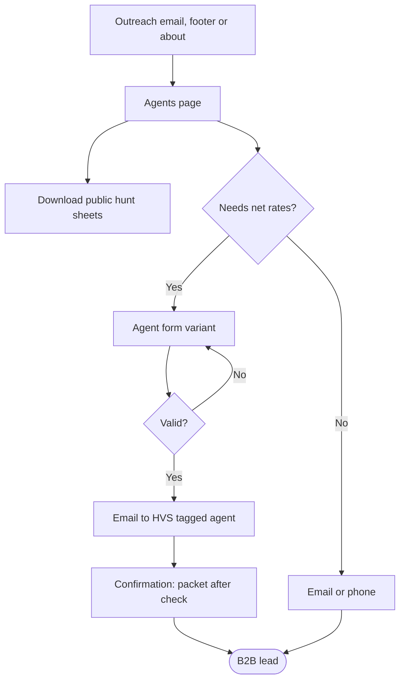
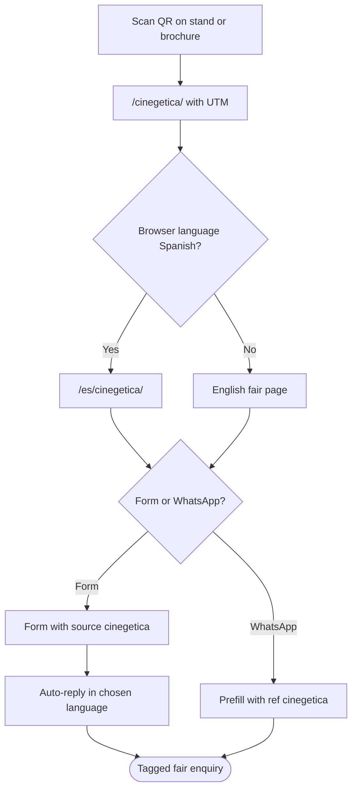
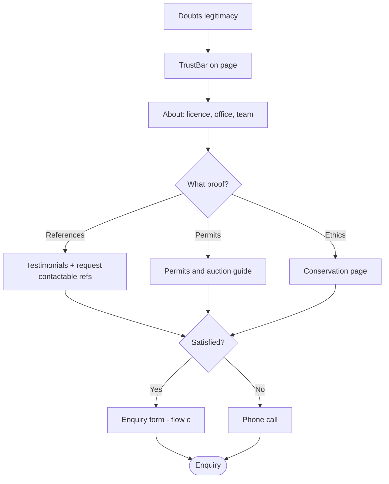
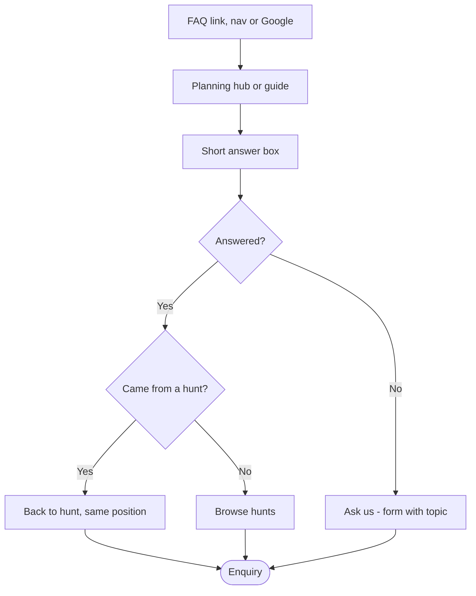
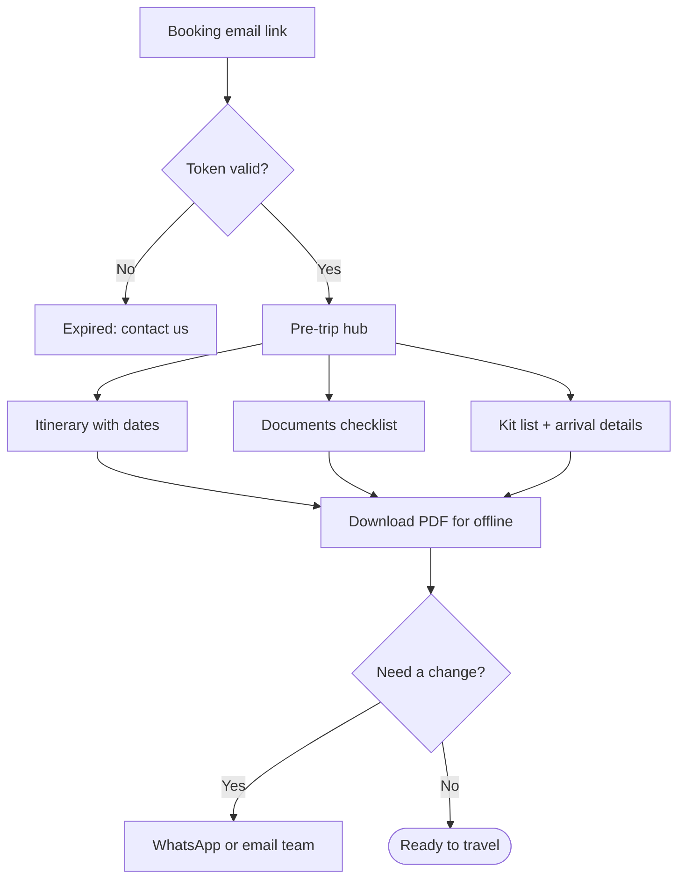

# User flows: huntventuresafaris.com

Owner: UX lead · Status: draft v1 · Date: 7 Nov 2026
Source of truth: `/home/claude/hvs-research/BRIEF.md` and the season 2027–28 brochures (`/home/claude/hvs-research/text/*.txt`). Anything not in those sources is marked **TBC (client to confirm)**. Prices are never shown; rates are **on request**.

Shared vocabulary used across workstreams:

- **Components (design system):** NavBar, HuntCard, AtAGlance, ItineraryTimeline, InclusionsList, RateTable, TrustBar, ElevationBand, EnquiryForm, ContactCard, Footer, Button. Components this document needs that are not on that list are marked **(new)**.
- **URLs (SEO architecture):** `/hunts/`, `/hunts/<species>/`, `/hunting-in-pakistan/<guide>/`, `/plan-your-hunt/`, `/about/`, `/conservation/`, `/contact/`, `/es/…`. URLs proposed here that are not on that list are marked **(new)**.

---

## 1. Personas

### P1. Richard, the experienced international trophy hunter

US or northern Europe, 55–70, SCI member, has hunted Central Asia (Tajikistan, Kyrgyzstan) or Mongolia. Markhor is the missing animal in his mountain collection. High budget, low patience for vagueness.

| | |
|---|---|
| Goals | Book a legal Astore markhor hunt with a credible outfitter for a specific season; know the real total cost; get the trophy home. |
| Must answer before enquiring | Is a permit actually available for 2027–28, and how does the government auction work? Which area and community? Success odds and trophy size (TBC). Total cost: package + what is excluded (trophy export, gratuities, insurance, rescue). Firearm import into Pakistan. Trophy export and CITES/import into his home country. Flights to Gilgit and what happens if they are cancelled (4x4 fallback is included). Altitude 2,500–4,700 m and fitness. Safety and security in Gilgit-Baltistan. Dates: hunting period 15 Oct–30 Apr, recommended mid Nov–mid Feb. |
| Anxieties | Paying a deposit to an outfitter he cannot verify; permit falling through after booking; trophy stuck in export; weather-cancelled flights eating hunting days; being physically out of his depth. |
| Devices and channels | Researches on a desktop or iPad in the evening; replies on phone. Email first; uses WhatsApp with outfitters he trusts. Will phone once serious. |
| Trust signals | Licence No. 2087, since 1989, government auction explained plainly, named community areas, references he can contact (TBC), real photos of past hunts with dates, SCI/fair presence, a reply within a stated time. |

### P2. Javier, the Spanish hunter met at Cinegética

Spain, 45–65, hunts ibex at home (Gredos, Beceite) and has collected abroad. Met HVS at the stand, took a brochure, and follows up days or weeks later.

| | |
|---|---|
| Goals | Re-find the outfitter he spoke to; compare the brochure he took with a second offer; get pricing for himself and possibly a friend. |
| Must answer before enquiring | Same as P1, in Spanish; plus whether HVS can deal in Spanish (TBC), how the EU import of the trophy works (TBC), whether the fair offer still stands. |
| Anxieties | Language barrier on detailed logistics; losing the contact; the price quoted at the fair not being honoured. |
| Devices and channels | Phone first. Scans the QR on the brochure or stand. WhatsApp is his default channel. |
| Trust signals | Recognises the brand and stand from the fair; site in Spanish; a page that says "we met at Cinegética"; WhatsApp answered by a person. |

### P3. Claire, the booking agent or hunting consultant (B2B)

Runs or works for an agency in the US, Europe or Gulf that packages hunts for clients. Contacted by HVS outreach or finds them while sourcing Pakistan.

| | |
|---|---|
| Goals | Source a reliable Pakistan outfitter, get specs she can paste into her own catalogue, agree net/commission terms, and resell. |
| Must answer before enquiring | Full spec per hunt (at-a-glance, itinerary, inclusions/exclusions); permit allocation per season; net rates and commission (TBC); deposit and payment terms (TBC); cancellation policy (TBC); who handles visa, firearm and trophy paperwork (firearm documentation and government liaison are included; trophy export is excluded); white-label PDF or imagery rights (TBC). |
| Anxieties | Reputational risk if the outfitter under-delivers; permit availability after she has sold the hunt; unclear responsibility for trophy export. |
| Devices and channels | Desktop, email-led, wants downloadable files. WhatsApp for quick checks once the relationship exists. |
| Trust signals | Company legal name and licence, office address, a dedicated agents page, clear terms, references from other agents (TBC), speed and precision of reply. |

### P4. Helen, the non-hunting companion

Partner or friend of P1/P2, 50–70. Not hunting but travelling. Often influences whether the trip happens.

| | |
|---|---|
| Goals | Understand what she will do and how comfortable it will be; feel safe. |
| Must answer before enquiring | Is there a companion rate (yes, column exists; price on request)? Where does she stay while the hunter is in camp: Gilgit or camp (TBC)? Activities: HVS also runs tours, treks and jeep safaris (details TBC). Altitude, cold, medical access (rescue is excluded; insurance advice TBC). Safety. |
| Anxieties | Being stuck in a cold camp for 15 days; health at altitude; security. |
| Devices and channels | Phone; often reads pages the hunter shares by WhatsApp. |
| Trust signals | A clear companion section on each hunt page; photos of accommodation (TBC); plain safety information. |

---

## 2. Jobs to be done and conversions

| Persona | Job (When… I want to… so I can…) |
|---|---|
| P1 | When I am planning my next mountain species, I want to confirm a legal permit, the real cost and the logistics in one place, so I can commit to a season with confidence. |
| P2 | When I get home from the fair, I want to find the outfitter I met and talk to them in Spanish, so I can get a firm offer while the conversation is fresh. |
| P3 | When I am sourcing hunts for clients, I want complete specs and trade terms quickly, so I can package and sell Pakistan without risk. |
| P4 | When my partner proposes this trip, I want to know what my days look like and that I will be safe, so I can say yes. |

### Core conversion: an enquiry

Four channels, all counted as the same conversion and tagged by channel:

| Channel | Trigger | Captured data |
|---|---|---|
| EnquiryForm | `/plan-your-hunt/` and inline on hunt pages | All qualifying fields + source |
| WhatsApp | `wa.me` link with prefilled message | Fields typed into the prefill; source in message text |
| Email | `mailto:` with prefilled subject/body | Same as WhatsApp |
| Phone | `tel:` link | None automatically; call logged by client manually |

### Qualified enquiry (definition)

An enquiry is **qualified** when it contains all five:

1. **Species / hunt** (one or more of the five products, or "not sure").
2. **Season** (2027–28 or later) and a preferred month or window.
3. **Party size**: number of hunters (1 or 2+) and non-hunting companions (0+).
4. **Country of residence** (drives firearm, trophy import and visa advice).
5. **A working contact**: email, plus optional WhatsApp/phone number.

Optional but valuable: previous mountain hunts, fitness self-rating, preferred language (EN/ES), agent or direct, how they heard of HVS.

### Secondary conversions

| Conversion | Purpose |
|---|---|
| Download hunt sheet PDF | Offline/print reading, sharing with partner or agent; signals intent. |
| Save / share hunt (native share sheet, copy link, WhatsApp share) | Spread to companion or hunting partner. |
| Next-season list ("Tell me when 2028–29 permits open") (new: SeasonAlertForm) | Captures hunters for whom this season is full or too soon. Email only, double opt-in. |
| Agent packet request | B2B lead (see flow e). |
| Click to call / click to email from ContactCard | Lower-intent contact. |

---

## 3. Information architecture

### 3.1 Sitemap

```
/                                   Home
├── /hunts/                         Hunts index (filter, compare)
│   ├── /hunts/astore-markhor/
│   ├── /hunts/himalayan-ibex/
│   ├── /hunts/blue-sheep/
│   ├── /hunts/blanford-urial-sindh-ibex/
│   └── /hunts/punjab-urial/        (profile only; detail on request)
├── /hunting-in-pakistan/           Planning hub (guides)
│   ├── /hunting-in-pakistan/permits-and-cites/     (permit auction, CITES)
│   ├── /hunting-in-pakistan/trophy-export/
│   ├── /hunting-in-pakistan/firearms/
│   ├── /hunting-in-pakistan/travel-and-logistics/  (flights, Gilgit, fitness, altitude, packing)
│   └── /hunting-in-pakistan/hunting-seasons/
├── /tours-and-expeditions/         Tours, trekking, jeep safaris, mountaineering
├── /plan-your-hunt/                Enquiry (EnquiryForm)
├── /thank-you/                     (new) confirmation, noindex
├── /conservation/                  Community areas, auction, sustainability
├── /about/                         Since 1989, licence 2087, team, references
├── /agents/                        (new) B2B: trade info, agent packet
├── /contact/                       ContactCard, map, office
├── /cinegetica/                    (new) trade-fair landing, noindex campaign page
├── /privacy/                       (new) data use for enquiries
├── /es/                            Spanish mirror (priority pages first)
│   ├── /es/cazas/ …                (hunt pages, slugs per SEO plan)
│   ├── /es/planificar-caceria/
│   └── /es/cinegetica/             (new)
└── /clients/                       (new, Phase 2) pre-trip hub, unlisted
```

URLs match the SEO architecture (`docs/seo/seo-architecture.md`), which owns final slugs. Safety and a general FAQ are folded into the guides and hunt pages for Phase 1, and become separate guides in Phase 2.

### 3.2 Page purposes and primary CTA

| Page | Purpose | Primary CTA | Secondary |
|---|---|---|---|
| Home | Prove legitimacy in five seconds; route to a hunt | Enquire (Button primary) | Browse hunts |
| Hunts index | Compare five hunts by season, altitude, duration, region | Open hunt (HuntCard) | Enquire |
| Hunt detail | Answer everything in the brochure sheet; convert | Enquire about this hunt | WhatsApp, Download hunt sheet |
| Planning hub + guides | Remove logistics doubts | Back to the hunt / Enquire | Related guide |
| Plan your hunt | Capture a qualified enquiry | Send enquiry | WhatsApp, email, phone |
| Conservation | Justify hunting ethically; explain auction and community areas | Enquire | About |
| About | History, licence, people, references | Enquire | Conservation |
| Agents (new) | Trade terms, specs, agent packet | Request agent packet | Email |
| Contact | All channels and address | WhatsApp (mobile) / Send enquiry (desktop) | Phone, email |
| Cinegética (new) | Welcome fair contacts, pre-tag source | Enquire (pre-tagged) | WhatsApp |

### 3.3 Global navigation (NavBar)

Five items + language + one primary action:

`[Logo] Hunts · Planning · Conservation · About · Contact    EN | ES    [Plan your hunt]`

- "Planning" links to `/hunting-in-pakistan/` (page H1: "Hunting in Pakistan"). "Tours & Expeditions" and "Agents" live in the footer and on About and Contact (low share of traffic, but direct link given in outreach emails).
- "Plan your hunt" is the only filled Button in the bar (brand crimson reserved for primary action); on mobile, where space is short, it may shorten to "Enquire".
- On hunt pages, Enquire deep-links to `/plan-your-hunt/?hunt=<slug>`.

### 3.4 Footer

| Column | Content |
|---|---|
| Company | Hunt Venture Safaris (Pvt) Limited · Govt. Licence No. 2087 · Since 1989 · Office address (Hotel Riveria, River View Road, Chinar Bagh, Gilgit, Gilgit-Baltistan, Pakistan – 15100) |
| Hunts | Five hunt links |
| Planning | Guide links |
| Company links | About · Conservation · Agents · Contact · Privacy |
| Contact | +92 311 166 7829 · +92 300 989 3205 · huntventuresafaris@gmail.com · WhatsApp (number TBC: which of the two is on WhatsApp) |
| Utility | EN / ES · Next-season list signup (SeasonAlertForm, new) |

### 3.5 Mobile navigation (Apple HIG principles)

- **Compact top bar:** logo (home), Enquire Button (primary), Menu button (standard icon + visible label "Menu" for clarity). All targets at least 44×44 px. Bar may use blur because it is floating chrome; content never does.
- **Menu:** full-height sheet with the five items as large rows (min 44 px), EN/ES segmented control, and contact rows (WhatsApp, Call, Email). Close button top-right; Esc and swipe-down close it; focus is trapped and returned to the Menu button.
- **Sticky bottom action bar (new: StickyActionBar)** on hunt pages only: one primary "Enquire" + one secondary icon-and-label "WhatsApp". Appears after the hero scrolls out; hides while the on-screen keyboard is open; respects safe-area insets.
- **One primary action per screen.** WhatsApp is always secondary styling, even though it is popular, so the hierarchy stays clear.
- Back navigation uses the browser; no custom back buttons. Breadcrumbs on hunt and guide pages at regular width only.

---

## 4. User flows

Flow notation: **[Entry]** → steps → **◇ decision** → **outcome**. Mermaid diagrams use quoted labels.

### Flow a. Discover → choose a hunt → enquire (Google → species page)

Persona: P1. Entry: Google search "Astore markhor hunt Pakistan" lands on `/hunts/astore-markhor/`.

1. **Land** on hunt detail hero: species name, area, season 2027–28, TrustBar (Licence 2087 · Since 1989 · Government-auctioned permits).
2. Scan **AtAGlance** (species, area, hunting period, recommended period, altitude, duration).
3. ◇ **Is this the right species and season?**
   - No → "Other hunts" row of HuntCards → open another hunt (restart at 2) or go to `/hunts/` (flow b).
   - Yes → continue.
4. Read **ElevationBand** and **ItineraryTimeline** (20 days, 15 hunting).
5. Read **InclusionsList** (included / not included) and **RateTable** (columns with "On request").
6. ◇ **Has an unanswered logistics question?** (permits, firearm, trophy export, flights)
   - Yes → inline FAQ answer or link to guide → flow h → "Back to Astore markhor" returns to the same scroll position.
   - No → continue.
7. ◇ **Ready to enquire?**
   - Yes, desktop → "Enquire about this hunt" → `/plan-your-hunt/?hunt=astore-markhor` (flow c).
   - Yes, mobile → StickyActionBar: Enquire (flow c) or WhatsApp (flow d).
   - Not yet → Download hunt sheet PDF or Share → secondary conversion; optional SeasonAlertForm.
8. **Outcome:** qualified enquiry with `hunt=astore-markhor`, `source=organic`.

Edge states: season closed or permits allocated → banner on hero and RateTable replaced by waitlist (section 7). Page slow to load → text and AtAGlance render first; gallery lazy-loads.



### Flow b. Compare hunts → pick → enquire

Persona: P1, P3. Entry: NavBar "Hunts", Home "Browse hunts", or "Other hunts" on a hunt page.

1. **Land** on `/hunts/`: five HuntCards with key specs visible on the card (area, recommended period, altitude, duration, start/end city).
2. Optional **filters** (new: HuntFilter; chips, multi-select, no page reload, state in URL query):
   - Month (Oct–Apr; matches hunting period, highlights recommended period)
   - Region: Gilgit-Baltistan mountains / Southern Pakistan
   - Altitude / effort: High (above 4,000 m) / Moderate / Low (flat terrain)
   - Duration: up to 10 days / 11–16 days / 20 days
3. ◇ **Results empty?** → message "No hunt matches all filters" + "Clear filters" + suggestion of the nearest match (for example, October only matches Astore markhor, whose hunting period opens 15 Oct).
4. Optional **compare** (new: CompareTable): select 2–3 cards → side-by-side table of the AtAGlance fields. On compact width the table becomes stacked rows with the species as sticky column header; max 2 at compact width.
5. ◇ **Pick one?**
   - One hunt → hunt detail (flow a from step 2).
   - A combination (e.g. markhor + ibex in one trip) → "Enquire about a combination" → form with multiple hunts preselected.
   - Undecided → "Not sure? Tell us what you want" → form with species "Not sure".
6. **Outcome:** enquiry with one or more `hunt` values, `source=hunts-index`.



### Flow c. Enquiry form in detail

Entry: `/plan-your-hunt/` (with or without `?hunt=`, `?src=`, `?lang=`) or inline EnquiryForm on a hunt page.

**Progressive structure** (single page, three short groups; the next group expands when the previous is valid; all fields remain visible and editable; works without JavaScript as one long form):

| Group | Field | Type | Rule |
|---|---|---|---|
| 1. Your hunt | Hunt(s) | Checkbox list of 5 + "Not sure yet" | Required, ≥1. Prefilled from `?hunt=` |
| | Season | Select: 2027–28, 2028–29, Later | Required |
| | Preferred month | Select Oct–Apr + "Flexible" | Optional. Inline note if outside the hunting period for selected hunt (soft warning, not a block) |
| | Hunters | Stepper 1–6 | Required, default 1 |
| | Non-hunting companions | Stepper 0–6 | Required, default 0 |
| 2. About you | Full name | Text, `autocomplete=name` | Required |
| | Email | Email, `autocomplete=email` | Required, format check |
| | Country of residence | Select (searchable), `autocomplete=country-name` | Required |
| | WhatsApp / phone | Tel with country code, `autocomplete=tel` | Optional; checkbox "Contact me on WhatsApp" |
| | I am | Radio: Hunter / Agent or consultant | Default Hunter; Agent reveals "Company" field |
| 3. Anything else | Previous mountain hunts | Textarea, short | Optional |
| | Questions | Textarea | Optional |
| | Language for reply | EN / ES | Defaults to page language |
| | Privacy consent | Checkbox, links to `/privacy/` | Required |
| Hidden | `source`, `hunt_ref`, `lang`, `utm_*`, `page_path` | Hidden | Set from URL/referrer |
| Hidden | Honeypot field | Hidden | Spam control |

**Validation**

- Validate on blur and on submit, never on each keystroke. Errors appear below the field in text (not colour alone), with `aria-describedby`; on submit, focus moves to an error summary at the top listing links to each faulty field.
- Do not clear entered data on error. Keep the draft in `sessionStorage` (wrapped in try/catch) so an accidental back or reload does not lose it.
- Submit Button shows a busy state ("Sending…") and is disabled to prevent double submits.

**Submission (static site)**

Recommended: a hosted form endpoint (**Formspree or Basin**) because the site has no build step and is on Vercel. It provides spam filtering, email delivery to **huntventuresafaris@gmail.com**, an autoresponder, and file-free storage of submissions. Alternative: a single Vercel serverless function posting to a transactional email API; more control (branded auto-reply, pre-tagging, Spanish templates) but needs maintenance. Decision: client/dev to confirm.

1. POST via `fetch` (progressive enhancement; plain HTML POST without JS, endpoint redirects to `/thank-you/`).
2. ◇ **Response OK?**
   - Yes → redirect to `/thank-you/?hunt=…` and send:
     - Internal email to huntventuresafaris@gmail.com. Subject: `[Enquiry] Astore Markhor · 2027–28 · 2 hunters + 1 companion · Spain · src=cinegetica`.
     - Auto-reply to the hunter in the chosen language: thanks, summary of what they sent, reply-time promise (**TBC**), WhatsApp link, link to the hunt sheet PDF.
   - No (network error, 4xx/5xx, timeout after ~15 s) → failure state (below).
3. **Confirmation screen** content:
   - Heading: "Thank you, [first name]. Your enquiry is with us."
   - Summary of their selections (hunt, season, party, country) with "Something wrong? Email us".
   - **What happens next** timeline (new: NextStepsTimeline):
     1. We confirm receipt (automatic email, now).
     2. A member of the team replies with availability and 2027–28 pricing (within **TBC** working days; client to set SLA; note Pakistan time zone, PKT UTC+5).
     3. We agree dates, party and any extras; you receive a written offer (deposit terms **TBC**).
     4. We start permit, visa and firearm paperwork.
   - Secondary: Download hunt sheet PDF, Read the planning guides, "Message us on WhatsApp".
   - No promotional content; no further form.
4. **Failure state:** inline panel above the Submit Button, not a new page: "We could not send your enquiry. Your details are saved on this page. Try again, or send them by WhatsApp or email." Buttons: Try again (primary), WhatsApp (prefilled with the form data), Email (mailto prefilled). Phone numbers shown as text.



### Flow d. WhatsApp-first (mobile)

Persona: P2, P1 on phone. Entry: StickyActionBar "WhatsApp" on a hunt page, ContactCard, or the `/cinegetica/` page.

1. Tap **WhatsApp** (secondary Button, 44 px min, WhatsApp icon + text label).
2. ◇ **Show a quick pre-sheet?** Recommended yes: a bottom sheet (new: WhatsAppSheet) with 3 optional quick fields: season, hunters, companions; plus a privacy note. "Open WhatsApp" Button and "Skip". (Skip sends the hunt-only prefill.)
3. Open `https://wa.me/<number>?text=<encoded>` (number **TBC**: which of +92 311 166 7829 / +92 300 989 3205 is on WhatsApp Business). Prefill per species and language, for example:
   - EN: `Hello Hunt Venture Safaris, I'm interested in the Astore Markhor hunt (season 2027–28). Hunters: 1. Companions: 0. Country: . Preferred month: . Ref: web/astore-markhor`
   - ES: `Hola Hunt Venture Safaris, me interesa la caza de Markhor de Astore (temporada 2027–28). Cazadores: 1. Acompañantes: 0. País: . Mes preferido: . Ref: web-es/astore-markhor`
4. ◇ **WhatsApp installed?**
   - Yes → app opens with message; user edits and sends.
   - No (desktop) → wa.me opens WhatsApp Web / download page; offer "Use the form instead" link next to the button on desktop. On desktop the WhatsApp button is shown as secondary text link, not the sticky bar.
5. **Privacy note** (under button): "WhatsApp is run by Meta. Your number and message will be visible to our team. For email only, use the form." Link to `/privacy/`.
6. **Outcome:** conversation opened (tracked as click, not as confirmed enquiry); `Ref:` token lets HVS tag the source manually.



### Flow e. Agent / B2B

Persona: P3. Entry: link in HVS outreach email (`/agents/?utm_source=outreach`), footer "Agents", About page, or form radio "Agent or consultant".

1. **Land** on `/agents/` (new): who HVS works with, what agents get (spec sheets, imagery, reply priority), licence and company details, trade terms headline (**TBC**: commission/net model, deposit, cancellation).
2. Download **spec pack** of public hunt sheets (PDFs) without gating.
3. ◇ **Wants net rates / agent packet?**
   - Yes → short form (EnquiryForm variant "agent"): name, company, country, website, email, WhatsApp, markets served, hunts of interest, expected clients per season → submit (same pipeline as flow c, subject prefix `[Agent]`).
   - No → contact by email (prefilled subject "Agent enquiry") or phone.
4. Confirmation: "We will send the agent packet (net rates, terms, imagery) by email after a short check" (verification step **TBC**; net rates must not be auto-sent).
5. **Outcome:** B2B lead tagged `type=agent`.



### Flow f. Trade-fair follow-up (Cinegética)

Persona: P2 (and any fair visitor). Entry: QR code on stand banner, brochure back page, or business card.

1. **QR** encodes `https://huntventuresafaris.com/cinegetica/?utm_source=cinegetica&utm_medium=qr&utm_campaign=2027` (one QR per placement to measure: `utm_content=stand|brochure|card`). Use a short, static URL so printed codes never break.
2. `/cinegetica/` reads `navigator.language`:
   - ◇ Spanish browser → redirect to `/es/cinegetica/` (keeping query string). Others stay on the English page. Language toggle visible either way; the choice is remembered.
3. **Page content:** "Encantados de conocerle en Cinegética" / "Good to meet you at Cinegética"; photo of the stand/team (TBC); the five hunts as compact HuntCards; any fair offer and its validity (**TBC**; omit if none); primary "Solicitar información" (form) and secondary WhatsApp.
4. Form or WhatsApp opens with `source=cinegetica` and `lang=es` pre-set (hidden field and `Ref: cinegetica` in the WhatsApp prefill).
5. ◇ **Visitor arrives after the campaign ends?** Page stays live with neutral copy ("Met us at a fair?"), never a 404.
6. **Outcome:** enquiry pre-tagged `source=cinegetica`, Spanish auto-reply.



### Flow g. Trust check (sceptical hunter)

Persona: P1, P3. Entry: any page; trigger is doubt ("is this outfitter real?").

1. Notice **TrustBar** (Licence No. 2087 · Since 1989 · Gilgit office · Permits via government auction) on Home and hunt pages.
2. Tap a TrustBar item → `/about/#licence`: legal name, licence number, scan of licence (**TBC**), office address with map, years operating, team (**TBC** bios).
3. ◇ **Wants independent proof?**
   - References → `/about/#references`: testimonials with name, country, year, species (with consent, **TBC**); "Ask us for references you can contact" → form with `topic=references`.
   - Permits → `/hunting-in-pakistan/permits-and-cites/`: how the open government auction allocates permits to Pakistani outfitters; what happens if the permit fee rises (minor absorbed; substantial invoiced separately).
   - Ethics → `/conservation/`: community-controlled hunting areas, contribution to conservation and local communities (specifics **TBC**).
   - Fair presence → "Find us at Cinegética" (dates TBC).
4. ◇ **Satisfied?** Yes → Enquire. No → Contact by phone (strongest trust channel for sceptics).
5. **Outcome:** enquiry or phone call; event `trust_path_completed`.



### Flow h. Logistics and planning information

Persona: P1, P3, P4. Entry: FAQ link on a hunt page, NavBar "Planning", or Google landing on a guide.

1. **Land** on `/hunting-in-pakistan/` (hub) or a guide. If arriving from a hunt page, the guide shows a "Back to Astore Markhor" chip (from `?from=astore-markhor`, falls back to referrer; hidden if neither).
2. Guides, each with a "Short answer" box first, then detail:
   - **Permits and auction**: open government auction; outfitter holds permit; included in package.
   - **CITES and trophy export**: trophy export is **not included**; skinning, salting and packing are included; CITES and home-country import rules per species and country **TBC (client to confirm)**.
   - **Firearm import**: firearm import/export documentation is included; what the hunter must provide **TBC**; option to use outfitter rifles **TBC**.
   - **Travel to Gilgit**: arrive Islamabad (Karachi for Sindh hunts); return flights Islamabad–Gilgit included; 4x4 transport included if flights are cancelled; visa assistance included; baggage up to 50 kg or 2 duffle bags.
   - **Fitness, altitude, packing**: altitude per hunt (2,500–4,700 m; Blue Sheep 3,200–4,500 m with trek in and out; Sindh 500–3,000 ft flat); kit list **TBC**.
   - **Safety**: guides, first aid kit included; rescue and insurance not included; insurance advice **TBC**.
3. ◇ **Question answered?**
   - Yes → "Back to the hunt" (preserves scroll) or "Enquire".
   - No → "Ask us this question" → form with `topic` prefilled from the guide.
4. **Outcome:** return to hunt page (assisted conversion) or direct question.



### Flow i. Returning visitor / booked client (Phase 2)

Persona: P1/P4 after booking. Entry: link in confirmation email to `/clients/<booking-token>/` (new, unlisted, noindex). Not in Phase 1; Phase 1 sends the same content as PDFs by email.

1. Open link from booking email.
2. ◇ **Token valid?** No → "This link has expired; contact us" with WhatsApp/email.
3. **Pre-trip hub:** confirmed itinerary (ItineraryTimeline with dates), documents checklist (passport, visa, firearm paperwork, insurance proof; items **TBC**), kit list, arrival details (Islamabad or Karachi hotel, pick-up), emergency contacts, weather fallback note.
4. Download all as one PDF for offline use in the mountains.
5. ◇ **Something to change?** → WhatsApp or email the team.
6. **Outcome:** prepared client, fewer support messages.



---

## 5. Page wireframes (text)

Compact = phone (≤ 430 px). Regular = tablet landscape / desktop (≥ 1024 px).

### 5.1 Home `/`

**Regular**
```
[NavBar: Logo | Hunts Planning Conservation About Contact | EN|ES | (Enquire)]
[Hero: landscape photo-10 | eyebrow "Trophy hunting in Pakistan · Season 2027–28"
       H1 "Mountain hunts in Gilgit-Baltistan since 1989" (copy TBC by brand)
       (Enquire) [Browse hunts]]
[TrustBar: Govt. Licence No. 2087 · Since 1989 · Karakoram, Himalaya, Hindu Kush · Government-auctioned permits]
[Section "Our hunts": 5 HuntCards in grid (3 + 2), each: photo, name, area, recommended period, altitude, duration, "View hunt"]
[Section "Why Hunt Venture Safaris": 2 paragraphs from brochure + link About]
[Section "Before you book": 4 tiles → permits, firearm, trophy export, travel to Gilgit]
[Section Conservation teaser: community-controlled areas → /conservation/]
[Section References (TBC; hide until supplied)]
[Enquiry band: short EnquiryForm (hunt, season, email) → continues on /plan-your-hunt/ | ContactCard]
[Footer]
```
**Compact**
```
[NavBar compact: Logo | (Enquire) | Menu]
[Hero image cropped; H1; (Enquire) full width; Browse hunts text link]
[TrustBar: 2x2 grid]
[HuntCards: single column, horizontal swipe NOT used (scannable stack)]
[Before you book: list rows with chevrons]
[Conservation teaser]
[ContactCard: WhatsApp · Call · Email rows, 44 px]
[Footer: accordion columns]
```

### 5.2 Hunt detail `/hunts/<species>/` (brochure structure)

**Regular**
```
[NavBar]
[Breadcrumb: Hunts / Astore Markhor]
[Hero: photo | eyebrow "Hunt details · Season 2027–28" | H1 "Astore Markhor Hunt"
       Status pill: "Permits available" / "Enquire for availability" / "Season full: join waitlist"
       (Enquire about this hunt) [WhatsApp] [Download hunt sheet PDF] [Share]]
[TrustBar slim]
[AtAGlance: 6 tiles - Species (+ scientific name) | Area | Hunting period | Recommended period | Altitude | Duration + start/end]
[ElevationBand: altitude range visual (e.g. 2,500-4,700 m) with Gilgit reference]
[ItineraryTimeline: Day 1 … Day 20, hunting block highlighted]
[Two columns: InclusionsList "Included" | "Not included"]
[RateTable: 1 Hunter | 2 Hunters | Non-hunting companion | Extra hunting day → each "On request"
             caption "Season 2027–28 · 20-day hunt · Islamabad to Islamabad · Full board"
             (Request 2027–28 pricing)]
[Permit note (new: NoteCallout): auction text verbatim from brochure]
[Companion section: what companions do (TBC)]
[Gallery (new: Gallery): 6-12 photos, lazy, lightbox, no blood images]
[FAQs (new: FaqAccordion): 6-8 Qs linking to guides]
[Inline EnquiryForm group 1 prefilled with this hunt → continues]
[Other hunts: 3 HuntCards]
[Footer]
```
**Compact**
```
[NavBar compact]
[Hero: H1, status pill, Download PDF + Share as text buttons]
[AtAGlance: 2-column tiles]
[ElevationBand: horizontal, simplified]
[ItineraryTimeline: vertical; long ranges collapsed ("Days 4-18: fifteen full hunting days")]
[InclusionsList: two disclosure groups, "Included (18)" open, "Not included (8)" closed]
[RateTable: stacked rows label → "On request"]
[Permit note] [Gallery: 2-col grid] [FAQs] [Other hunts]
[StickyActionBar (new): (Enquire) [WhatsApp]]  ← after hero leaves viewport
```
Punjab Urial page: hero, AtAGlance with known fields (area Kala Bagh, Jhelum, Padri; best time Dec–Mar; 5 hunting days max), "Full hunt sheet on request", Enquire. No itinerary or RateTable.

### 5.3 Hunts index `/hunts/`

**Regular**
```
[NavBar] [H1 "Hunts, season 2027–28" + 1-line intro]
[HuntFilter chips (new): Month | Region | Altitude/effort | Duration   (Clear)]
[Result count "5 hunts"]
[HuntCard grid with checkbox "Compare"]
[CompareTray (new), bottom: "2 selected (Compare)" → CompareTable (new) modal/section]
[Season calendar strip (new: SeasonCalendar): Oct-Apr rows per hunt, hunting period vs recommended period]
[Not sure? → (Enquire) "Tell us what you want"]
[Footer]
```
**Compact**
```
[Filters behind "Filter (n)" button → sheet with chips and "Show 3 hunts" primary]
[HuntCards stacked; Compare checkbox; max 2 to compare]
[SeasonCalendar: scrolls horizontally inside its own container only]
```

### 5.4 Plan your hunt `/plan-your-hunt/`

**Regular**
```
[NavBar (Enquire hidden: current page)]
[H1 "Plan your hunt" | intro: "Tell us what you'd like to hunt. We reply with availability and 2027-28 pricing." + reply time TBC]
[Left 2/3: EnquiryForm (3 groups, section 4c)]
[Right 1/3: Summary card of selections (live) | "Prefer to talk?" ContactCard: WhatsApp, Call, Email | TrustBar vertical]
[Footer]
```
**Compact**
```
[H1 + intro]
[Channel switcher row: Form (selected) | WhatsApp | Call]
[EnquiryForm single column, large inputs, native selects, numeric keyboard for tel]
[Submit full width]
[ContactCard]
```

### 5.5 Contact `/contact/`

**Regular**
```
[NavBar] [H1 "Contact"]
[ContactCard: Phone x2 · WhatsApp · Email · Office address · Hours (TBC) · Time zone PKT]
[Map (static image linking to maps app; no heavy embed)]
[Short EnquiryForm or link "For hunt enquiries use Plan your hunt"]
[Agents? → /agents/]
[Footer]
```
**Compact**
```
[ContactCard rows: WhatsApp (primary), Call, Email, Directions; each 44 px+]
[Address text, copyable]
[Link to Plan your hunt]
```

---

## 6. Content requirements

### 6.1 Per flow step

| Flow / step | Copy or data that must exist | Source |
|---|---|---|
| a.1 Hero | Hunt name, season, status (available / waitlist), hero photo per species | Brochure; status and photos TBC |
| a.2 AtAGlance | Species + scientific name, area, hunting period, recommended period, altitude, duration, start/end | Brochure (all five) |
| a.4 Itinerary | Day-by-day lines | Brochure (4 hunts); Punjab Urial TBC |
| a.5 Inclusions / RateTable | Lists; column labels; "On request"; caption | Brochure |
| a.5 Permit note | Auction paragraph | Brochure (verbatim) |
| a.6 FAQs | 6–8 Q&A per hunt | Draft from brochure; client to check |
| b.2 Filters | Month ranges, region, effort level per hunt | Derived from brochure; effort labels TBC |
| c Form | Field labels EN/ES, error messages, consent text, privacy policy | New copy; privacy policy TBC |
| c Auto-reply | EN/ES templates, reply SLA, signature | TBC |
| c Thank-you | Next-steps timeline, deposit wording | TBC |
| d WhatsApp | Business number, prefill templates per hunt EN/ES, privacy note | Number TBC |
| e Agents | Trade terms, net/commission, packet contents | TBC |
| f Cinegética | Welcome copy EN/ES, stand photo, fair offer and validity, QR codes | TBC |
| g Trust | Licence scan, team bios, testimonials with consent, conservation facts | TBC |
| h Guides | Permits, CITES/export, firearm import, travel, fitness, safety copy | Partly brochure; specifics TBC |
| i Pre-trip | Documents checklist, kit list, arrival procedure, emergency contacts | TBC (Phase 2) |

### 6.2 Gap list: content the client must supply

Priority 1 (blocks launch or conversion):

1. **Price policy**: confirm "on request" everywhere, and whether any "from" figure may ever be shown.
2. **Reply SLA**: promised reply time (for example "within 2 working days") and working hours in PKT.
3. **WhatsApp number**: which of the two numbers is on WhatsApp (Business), and who answers in Spanish.
4. **Availability per hunt for 2027–28**: permits held / available / waitlist, refreshed when the auction result is known; when the auction happens each year.
5. **Deposit and payment terms**: amount, timing, currency, method.
6. **Cancellation and refund policy**, including permit-fee rises, weather and force majeure.
7. **Privacy policy** for enquiry data (form service, email, WhatsApp).
8. **Photos per hunt area** (hero + 6–12 gallery), with dates and permission; no blood imagery for heroes.

Priority 2 (trust and logistics depth):

9. **References/testimonials** with written consent (name, country, year, species); willingness to give contactable references.
10. **Guide and team bios** with photos.
11. **Licence evidence** (scan or verifiable registry reference).
12. **CITES and trophy-export specifics** per species, cost range or process for export (excluded from package), typical timelines, destination-country notes (US, EU/Spain).
13. **Firearm import requirements**: what the hunter provides, calibres, rifle rental option.
14. **Insurance and rescue advice**: recommended cover, helicopter rescue arrangements (excluded).
15. **Success rates and trophy sizes** per species (only if verifiable).
16. **Companion programme**: where companions stay, activities, comfort level.
17. **Conservation facts**: community areas involved, how fees flow to communities.

Priority 3:

18. Agent terms and agent packet contents.
19. Cinegética dates, stand number, any fair offer.
20. Punjab Urial full hunt sheet.
21. Spanish translations reviewed by a native speaker.
22. Vector (SVG) logo (flagged by brand workstream).

---

## 7. Edge cases and states

| Case | Behaviour |
|---|---|
| Season closed or permits sold out | Hero status pill "Season 2027–28 full"; RateTable replaced by "Join the waitlist for 2028–29" SeasonAlertForm (email, hunt, party size); Enquire stays available labelled "Ask about cancellations". Status driven by one data file so the client can change it without code. |
| Species not available this season | Hunt page stays live (SEO); status "Not offered in 2027–28"; links to closest alternative (e.g. Himalayan Ibex ↔ Blue Sheep). Hidden from default index filter, shown with "Show unavailable". |
| Enquiry for dates outside the hunting period | Soft inline warning: "Legal hunting for Himalayan Ibex runs 1 Nov – 26 Apr. We'll suggest the nearest dates." Submission still allowed. |
| Permit fee rises after booking | Covered in permit note and FAQ (brochure wording); no UI state. |
| Slow connections (Gilgit, rural users, mobile data) | Static HTML; critical CSS inline; images AVIF/WebP with `srcset`, lazy below the fold; hero ≤ 150 KB on compact; no video autoplay; no map embeds; web fonts subset with `font-display: swap`; total page weight target ≤ 1 MB on hunt pages; text and AtAGlance readable before images load. Form works without JS. |
| Offline / print | Hunt sheet PDF per species (EN/ES) mirroring brochure; print stylesheet for hunt pages (hide nav, gallery, sticky bar; keep AtAGlance, itinerary, inclusions, contact). |
| Form endpoint down | Failure panel with WhatsApp/email fallbacks prefilled (flow c). |
| JS disabled | Filters render as plain links to anchored sections; compare hidden; form posts natively. |
| Accessibility: keyboard | All controls reachable in logical order; visible focus ring; skip link; menu sheet traps and returns focus; Esc closes sheets and lightbox. |
| Accessibility: screen readers | Landmarks; one H1 per page; AtAGlance as description list; ItineraryTimeline as ordered list; RateTable as real `<table>` with headers; status pill text not colour-only; form errors announced via `aria-live`; alt text for every hunt photo. |
| Reduced motion / transparency | No parallax; ElevationBand and sticky bar appear without animation; blur on NavBar replaced by solid colour when `prefers-reduced-transparency`. |
| Contrast | WCAG AA in light and dark for text and all states (error, disabled, focus). |
| Language switch retaining context | Switcher links to the equivalent page (`hreflang` pairs), keeps query string (`hunt`, `src`, filter state) and scroll anchor; form draft persists across switch via `sessionStorage`; if no Spanish equivalent exists yet, go to `/es/` with notice "Esta página aún no está en español" and link back. Preference remembered; never auto-redirect except on `/cinegetica/`. |
| Duplicate submit / double click | Button disabled while sending; endpoint dedupe by email + hunt within 10 min if supported. |
| Spam | Honeypot + endpoint filtering; no CAPTCHA unless spam becomes a problem (accessibility cost). |
| Very old browsers / in-app browsers (WhatsApp, Instagram) | Test that `wa.me`, `tel:`, PDF download and form work inside in-app browsers. |

---

## 8. Measurement

Use privacy-friendly analytics (Vercel Web Analytics custom events or similar; no cookie banner needed if cookieless, to confirm). Every event carries `page_path`, `lang`, `device`, `source`/UTM.

| Flow | Funnel events (in order) | Key metric |
|---|---|---|
| a. Species page | `hunt_view{hunt}` → `scroll_itinerary` → `scroll_rates` → `faq_open{q}` → `cta_enquire_click{hunt,location}` → `form_start` → `enquiry_submit` | Hunt view → enquiry rate per hunt |
| b. Compare | `hunts_index_view` → `filter_apply{type,value}` → `filter_empty` → `compare_open{hunts}` → `huntcard_click{hunt}` → `enquiry_submit` | Index → hunt click-through; empty-result rate |
| c. Form | `form_view` → `form_start` → `form_group_complete{1,2,3}` → `form_error{field}` → `form_submit_attempt` → `form_submit_success` / `form_submit_fail{reason}` → `fallback_click{channel}` | Start → success rate; drop-off by group; fail rate |
| d. WhatsApp | `whatsapp_click{hunt,location}` → `whatsapp_sheet_fill` / `whatsapp_sheet_skip` → `whatsapp_open` | Clicks per hunt view; HVS logs `Ref:` tokens manually |
| e. Agents | `agents_view` → `spec_pdf_download{hunt}` → `agent_form_start` → `agent_form_submit` | Agent leads per month; outreach UTM conversion |
| f. Cinegética | `qr_landing{utm_content}` → `lang_redirect{es}` → `cta_click` → `enquiry_submit{source=cinegetica}` | Scans → enquiries per placement |
| g. Trust | `trustbar_click{item}` → `about_view` → `references_view` → `conservation_view` → `enquiry_submit` | Share of enquirers who visited trust pages |
| h. Planning | `guide_view{guide,from}` → `short_answer_seen` → `back_to_hunt_click` / `guide_ask_click{topic}` | Return-to-hunt rate; most-asked topics |
| i. Pre-trip (Phase 2) | `client_hub_view` → `checklist_item_open` → `pdf_download` → `contact_click` | Support messages per booking |
| Secondary | `pdf_download{hunt,lang}`, `share_click{method}`, `season_alert_submit{hunt}`, `tel_click`, `mailto_click`, `lang_switch{from,to}` | — |

Offline outcomes to record manually (simple sheet or CRM, **TBC**): enquiry qualified (yes/no), quote sent, deposit paid, by `source` and channel. This closes the loop from web event to booking.
